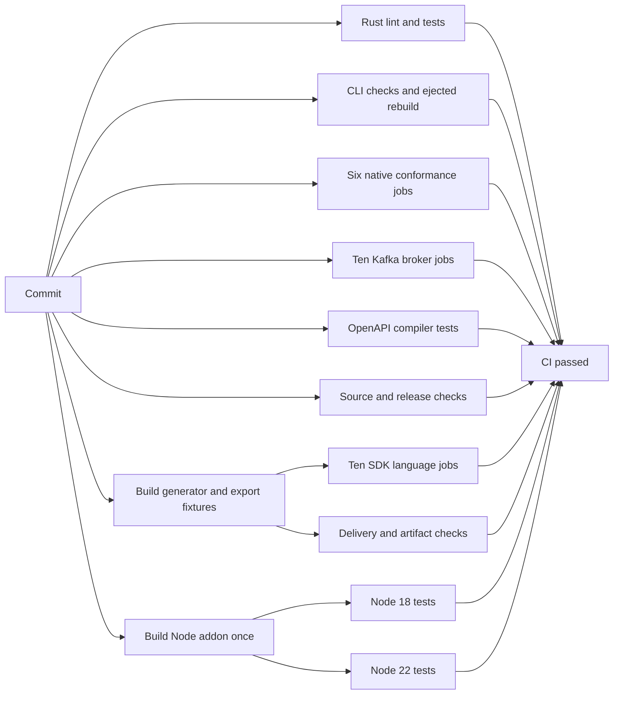

# CI integration

Poolster ships repository-owned integrations for GitHub Actions and GitLab CI. Both
install the published npm launcher, so CI needs Node but not Rust or Go.

**On this page:** [GitHub](#github-actions) · [GitLab](#gitlab-ci) · [Marketplace](#github-marketplace) · [Poolster release](#publishing-poolsters-npm-packages) · [SDK repos](#generated-sdk-repositories)

## GitHub Actions

```yaml
steps:
  - uses: actions/checkout@v4
  - uses: rlvtapp/poolster/packages/integrations/github@main
    with:
      config: api/poolster.json
```

The action accepts `config`, `version`, and `working-directory`. Pin the action
and npm `version` to a release in production. See the
[action README](../../../packages/integrations/github/README.md) for all inputs.

## GitLab CI

```yaml
include:
  - remote: 'https://raw.githubusercontent.com/rlvtapp/poolster/<poolster-release-tag>/packages/integrations/gitlab/poolster.yml'

generate-sdk:
  extends: .poolster:generate
  variables:
    POOLSTER_CONFIG: api/poolster.json
```

| Variable | Controls |
| --- | --- |
| `POOLSTER_CONFIG` | Recipe path |
| `POOLSTER_VERSION` | Launcher version |
| `POOLSTER_WORKING_DIRECTORY` | Working directory |

**Linux requires glibc.** The template uses Debian-based Node; Alpine/musl is
unsupported by the published launcher. See the
[template README](../../../packages/integrations/gitlab/README.md).

## GitHub Marketplace

The repository-local action can be used directly, but it cannot be listed in
GitHub Marketplace: Marketplace actions require one `action.yml` at the root of
a public action repository.

When Poolster is ready to publish a Marketplace action,
create a small dedicated public repository (for example `rlvtapp/poolster-action`)
whose root contains this action, release it under a stable tag, and publish that
release from GitHub.
Do not add a root action metadata file to this monorepo
solely for Marketplace discovery.

## Poolster repository checks

The repository CI runs independent suites in parallel. Rust lint, the full Rust
suite, CLI schema/reference/migration checks, the ejected CLI rebuild, and the
OpenAPI compiler each have their own job. Native TypeScript HTTP/GraphQL,
frameworks, Postman, Terraform, SDK mock contracts, and the plugin example run
as six independent jobs in `native-conformance.yml`. Kafka keeps its separate
ten-language broker matrix. PHP, Elixir and Swift broker probes run there with
their required native toolchains; SDK jobs run their HTTP/GraphQL probes with
pinned GraphQL.js and graphql-sse servers.

Fixture generation does not wait for those test suites. It builds the generator,
checks output structure and regeneration, and exports the generated SDK, public
contract, and runtime fixtures. The ten-language SDK compilation/runtime matrix
and delivery checks start when those artifacts are ready.

The Node addon and OpenAPI compiler are built once, then shared with separate
Node 18 and Node 22 test jobs. Downloaded executables have their executable bits
restored before use. Every job remains required by the final **CI passed** gate;
parallel execution does not remove tests or accept skipped/failed jobs.



## Publishing Poolster's npm packages

`.github/workflows/npm-publish.yml` is the release workflow. Pushing a version
tag such as `v0.5.0` builds each native package on its target platform, then
publishes CLI and SDK native packages before `poolster` and `@relevate/poolster`
after the release verification jobs pass. Manual retries must select a version tag.
The SDK addon is only installed with `@relevate/poolster`; CLI-only installs use
`poolster` and do not download it.

The workflow uses npm trusted publishing via GitHub Actions OIDC. Configure the
same `npm-publish.yml` workflow name as a trusted publisher for every npm
package it publishes. It needs no `NPM_TOKEN`; only its final publish job has
`id-token: write`. Keep that permission out of normal CI and build jobs.
The new `poolster` and `@relevate/poolster-node-<platform>` names need an initial
publication by an authorized maintainer before npm trusted publishing can be
configured for them.

Enter these values for each npm package's GitHub Actions trusted publisher:

| Field | Value |
| --- | --- |
| Organization or user | `rlvtapp` |
| Repository | `poolster` |
| Workflow filename | `npm-publish.yml` (filename only) |
| Environment name | Leave blank; the publish job has no environment |
| Allow npm publish | Enabled |
| Allow npm dist-tag | Disabled; the workflow uses `npm publish --tag`, not `npm dist-tag` |

Register every package, including `poolster`, `@relevate/poolster`,
`@relevate/poolster-plugins`, all language/auxiliary/input packages,
`@relevate/unplugin-poolster`, and the CLI and Node native packages for
`darwin-arm64`, `darwin-x64`, `linux-x64-gnu`, and `win32-x64-msvc`.
The GitHub owner is `rlvtapp`; the npm scope remains `@relevate`.
See [npm trusted publishing](https://docs.npmjs.com/trusted-publishers/).

For the PyPI `poolster` project, select GitHub and enter owner `rlvtapp`,
repository `poolster`, workflow `npm-publish.yml`, and a blank environment.
PyPI has no npm allowed-actions checkboxes. See
[PyPI publisher setup](https://docs.pypi.org/trusted-publishers/adding-a-publisher/).
Rust publication uses crates.io trusted publishing through the official
[`rust-lang/crates-io-auth-action`](https://github.com/rust-lang/crates-io-auth-action).
It exchanges the job identity for a temporary token and revokes that token when
its job ends. A long-lived `CRATES_IO_TOKEN` secret is no longer required.

For **each public Poolster crate**, open its crates.io settings/security page and
add a GitHub Actions trusted publisher with owner `rlvtapp`, repository `poolster`,
workflow filename `npm-publish.yml`, and no environment. Configuring npm trust
does not configure crates.io trust. The existing `poolster` crate and all public
workspace dependencies need their own entries. Print the complete list without
uploading anything:

```sh
python scripts/publish-crates.py --plan --tag "v$(cat version.txt)"
```

The Rust publish job alone receives `id-token: write`. Cargo still performs the
package verification and publishes dependencies before consumers. If a job fails,
its next run obtains a fresh temporary token and skips already published versions.
Local `cargo login` does not establish the GitHub workflow's trusted identity.

Publication is serialized across releases. A manual `windows_only` run builds
artifacts but cannot publish to any registry. Retry a failed publish job using
its original artifacts: npm recovery skips an existing version only if its
SHA-512 integrity matches the packed artifact, preserving existing dist-tags.
Rebuilding native binaries can produce different bytes and requires investigation
rather than overwriting an existing version. PyPI retries skip existing wheels;
Cargo's publication helper already supports dependency ordering and recovery.

Require the `CI passed` status in GitHub branch protection/rulesets. This final
check requires source checks, generator tests, Node SDK checks, all language jobs and Kafka
conformance to succeed, including when an upstream job fails or is skipped.

CI runs source/integration checks alongside the generator build. Rust dependency
caches are scoped by workflow, job, toolchain and platform; only main writes caches.
Native Kafka conformance runs independently for TypeScript, Go, Rust, Python,
Java and C#, and must pass before release publication. Each job starts a pinned
local broker and retains adapter reports and broker diagnostics. A normal
`cargo test --workspace` leaves these external-toolchain tests ignored.

The tag version must match `packages/npm/cli/package.json` and
`packages/npm/sdk/package.json`. Publish a
release only after the tag is protected and the trusted-publisher relationship
has been configured in npm.

## Generated SDK repositories

Optional `poolster sdk init` scaffolds build/test and release workflows from
plugin-emitted package metadata. See [SDK automation](sdk-automation.md) for
independent versions, diff sizing, custom registries, repository synchronization,
and required repository setup. Review with `--dry-run` before writing the files.
